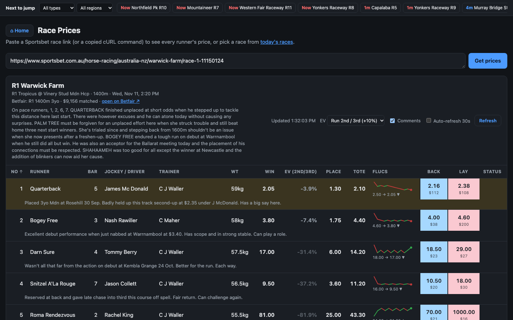
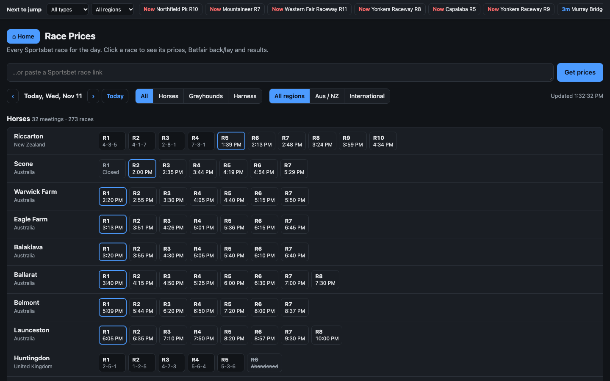
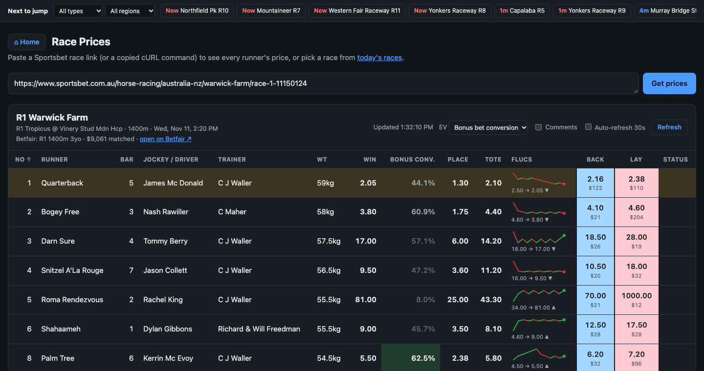
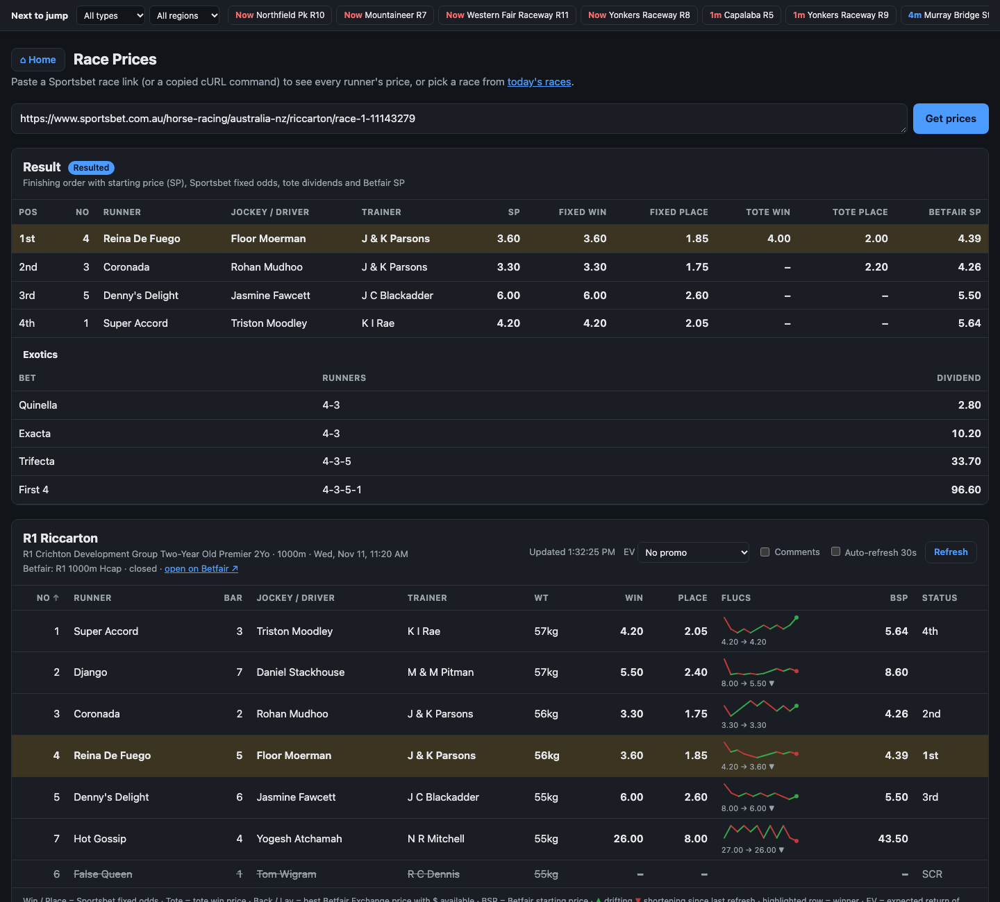
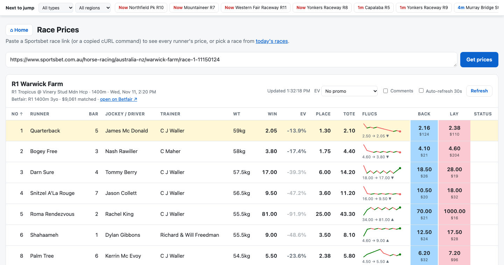
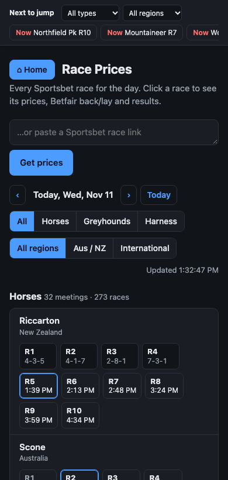

# Sportsbet Race Prices

A Python web app for Australian and international racing (horses, greyhounds and harness) that
puts **Sportsbet's prices** side by side with the **Betfair Exchange**. It works out the
**expected value (EV)** of each bet, including bonus bets and promos, and keeps a **MySQL
history** of results and Betfair Starting Prices.

It runs on your own computer at http://127.0.0.1:5050. The Sportsbet side needs no account.
Betfair and the database are optional extras.



**At a glance**

- Every Sportsbet race for the day, filterable by race type and region, with a **Next to jump** bar on every page.
- For each runner:
  - Sportsbet fixed odds and tote prices
  - Betfair **back (blue) / lay (pink)**
  - **EV** with or without promos
  - a **price fluctuation graph**
  - Sportsbet's **form comments**
- For finished races: the finishing order, dividends, exotics and **Betfair SP (BSP)**.
- Every finished race saved automatically to **MySQL**: results, BSP, comments and price history.

---

## Contents

- [Features](#features)
- [Screenshots](#screenshots)
- [Quick start](#quick-start)
- [Configuration (`.env`)](#configuration-env)
- [Betfair setup](#betfair-setup)
- [Results database (MySQL)](#results-database-mysql)
- [Using the app](#using-the-app)
- [How EV is calculated](#how-ev-is-calculated)
- [How BSP is captured](#how-bsp-is-captured)
- [Command-line tool](#command-line-tool)
- [How it works](#how-it-works)
- [Built with](#built-with)
- [Project structure](#project-structure)
- [Web API](#web-api)
- [Troubleshooting](#troubleshooting)
- [Limitations](#limitations)

---

## Features

### Home page
- Every Sportsbet race for the day: horses, greyhounds and harness, Australian/NZ and international.
- Filter by **race type** and **region**, and step through days with ‹ ›.
  Sportsbet keeps about a week of past race days.
- Each race shows its start time, or its placings (e.g. `4-3-5`) once run. The next race at
  each meeting is outlined, closed races are labelled, and abandoned ones are crossed out.

### "Next to jump" bar (every page)
- Stays at the top of the screen as you scroll.
- Shows the next 12 open races with live countdowns, which turn red inside 2 minutes.
- Has its own **race type** and **region** dropdowns, kept in sync with the home page filters
  and remembered between visits.
- Highlights the race you're currently viewing.

### Race page
| Feature | Details |
|---|---|
| **Runner details** | Number, barrier, jockey/driver, trainer, weight |
| **Sportsbet prices** | Fixed Win and Place odds, and the tote win price |
| **Betfair prices** | Best **Back** (blue) and **Lay** (pink) prices with the $ available, matching betfair.com.au (cross-matched prices included), plus a link to the market |
| **EV column** | Four modes: **No promo**, **Bonus bet conversion**, **Run 2nd (+5%)**, **Run 2nd / 3rd (+10%)**. Hover a cell to see the working. See [How EV is calculated](#how-ev-is-calculated) |
| **Flucs** | A small graph of the Sportsbet price from open to now. Green steps = drifting (price up), red = shortening (price down) |
| **Comments** | Sportsbet's form comment under each runner, plus the race overview. Toggle with **Comments** |
| **Refresh** | A Refresh button and optional 30-second auto-refresh. ▲/▼ markers show prices that moved since the last refresh |
| **Sorting** | Click any column header. The favourite is highlighted, and scratched runners are struck out and listed last |

### Finished races
- A **Result** table with:
  - the finishing order, jockey and trainer
  - Sportsbet SP and final fixed odds
  - tote win/place dividends
  - the **Betfair SP**
- **Exotics**: Quinella, Exacta, Trifecta and First 4 dividends.

### Results database
- Every finished race saved to **MySQL** automatically, every 5 minutes, while the app runs.
- Stores results, dividends, BSP, comments and full price histories, ready for SQL analysis.

### Command-line tool
- Prints a race's prices and results in the terminal, or saves them as CSV, using plain `python3`.

---

## Screenshots

### Home page: every race for the day


The blue-outlined race is each meeting's next race to run. Finished races show their placings.

### Next to jump bar with filters


The bar is filtered here to **Greyhounds** and **Aus / NZ**. The same choice applies to the home page.

### Race page: EV, Flucs, comments and Betfair


- **EV (2nd/3rd)** shows each runner's value with the Run 2nd/3rd promo (+10%).
- **Flucs** graphs the Sportsbet price history.
- **Back** / **Lay** are Betfair's best prices, with the amount available underneath.
- Comments sit under each runner.

### Bonus bet conversion


In **Bonus bet conversion** mode, the column shows how much of a bonus bet you'd expect to keep
as cash. The best runner (here Palm Tree, 62.5%) is highlighted.

### Finished race: results, dividends and Betfair SP


**SP** is Sportsbet's starting price, and **Betfair SP** is the exchange's starting price.
They usually differ: the bookmaker SP includes Sportsbet's margin, while BSP is set by
exchange bettors.

### Light mode


The app follows your computer's light/dark setting.

### On a phone


---

## Quick start

You need **Python 3.10+**. It was developed with Python 3.13 on macOS.

```bash
git clone git@github.com:datran11171/sportsbet-scraper.git
cd sportsbet-scraper

# First time only
python3 -m venv .venv
.venv/bin/pip install -r requirements.txt

# Run
.venv/bin/python app.py
```

Open **http://127.0.0.1:5050**. Press **Ctrl+C** in that terminal to stop it.

That's enough for Sportsbet prices, results, Flucs and comments. Then add whichever extras
you want:

| Extra | What you get | Setup |
|---|---|---|
| Betfair | Back/Lay, EV, BSP | [Betfair setup](#betfair-setup) |
| MySQL | Saved history of every finished race | [Results database](#results-database-mysql) |

> On Windows, use `.venv\Scripts\python app.py` and `.venv\Scripts\pip ...`.

---

## Configuration (`.env`)

All settings live in a file called `.env` in the project folder. It's in `.gitignore`, so it's
never committed. Real environment variables with the same names override it.

```ini
# Betfair (optional): needed for Back/Lay, EV and BSP
BETFAIR_APP_KEY=your-app-key
BETFAIR_USERNAME=your-betfair-username
BETFAIR_PASSWORD=your-betfair-password
# BETFAIR_SESSION_TOKEN=...       # alternative to username/password

# MySQL (optional): needed for the results database
MYSQL_HOST=127.0.0.1
MYSQL_PORT=3306
MYSQL_DATABASE=racing
MYSQL_USER=racing
MYSQL_PASSWORD=choose-a-password
MYSQL_ROOT_PASSWORD=choose-another-password
```

Restart the app after changing `.env`.

---

## Betfair setup

1. **Get an app key.** Follow the "application keys" guide on the
   [Betfair Developer Program](https://developer.betfair.com/) site while logged in to your
   Betfair account.
   - A **delayed** key is free, but its prices can lag the live market slightly.
   - A **live** key has to be requested from Betfair.
2. **Add the `BETFAIR_*` lines** to `.env` (see above).
3. **Restart the app.** It logs in through `identitysso.betfair.com.au` and logs in again by
   itself when the session expires.

Without Betfair, the race page shows a note in place of Back/Lay, and the EV and BSP columns
are hidden.

---

## Results database (MySQL)

### Setup

MySQL runs in Docker, so you need [Docker Desktop](https://www.docker.com/products/docker-desktop/)
installed and **open**.

1. Add the `MYSQL_*` lines to `.env`, choosing your own passwords.
2. Start the database:

   ```bash
   docker compose up -d        # first run downloads MySQL 8.4 and creates the database
   ```

3. Start the app. It creates the tables, logs
   `Saving resulted races to MySQL every 5 minutes`, and from then on saves each newly finished
   race from today and yesterday.

The database only listens on `127.0.0.1`. Its data lives in a Docker volume, so it survives
restarts and reboots, and it starts again whenever Docker Desktop does.

| Command | Does |
|---|---|
| `docker compose stop` | Stop the database |
| `docker compose up -d` | Start it again |
| `docker compose down -v` | **Delete it and all saved data** |

### Saving by hand / backfilling

```bash
.venv/bin/python db.py save              # save today's and yesterday's finished races now
.venv/bin/python db.py save --days 7     # backfill the last week (Sportsbet keeps about a week)
.venv/bin/python db.py stats             # row counts and BSP status breakdown
```

Backfilled races get results, comments and price history. They only get **BSP if the app
saved their Betfair market while it was open** (see [How BSP is captured](#how-bsp-is-captured)).

### Tables

| Table | One row per | Main columns |
|---|---|---|
| `races` | race | `race_id` (Sportsbet event id), `race_date`, `venue`, `race_type`, `region`, `race_number`, `distance_m`, `start_time_utc`, `race_comment`, `betfair_market_id`, `bsp_status` |
| `runners` | runner | `finish_position`, `runner_name`, `barrier`, `jockey`, `trainer`, `weight_kg`, `scratched`, `open_price`, `fixed_win`, `fixed_place`, `sportsbet_sp`, `tote_win`, `tote_place`, `bsp`, `runner_comment` |
| `price_fluctuations` | price move | `race_id`, `runner_number`, `seq` (0 = opening price), `price` |
| `exotic_results` | exotic bet | `bet_type`, `runners` (e.g. `4-3-5`), `dividend` |

`sportsbet_sp` and the tote dividends only exist for placegetters, because that's all
Sportsbet publishes. `fixed_win` is every runner's final fixed price.

**`bsp_status`** says whether a race has BSP:

| Value | Meaning |
|---|---|
| `ok` | BSP saved |
| `pending` | Betfair market found but BSP not settled yet (or Betfair errored). Retried each run for 24 hours, then `missing`. |
| `not_saved` | Betfair has markets at this venue, but this race closed before the app saved its market |
| `not_found` | No Betfair market seen at this venue. Either Betfair doesn't cover it, or the app wasn't running while its markets were open. |
| `no_betfair` | Betfair isn't set up |

### Example queries

```sql
-- Winners: Sportsbet SP vs Betfair SP
SELECT r.race_date, r.venue, r.race_number, u.runner_name, u.sportsbet_sp, u.bsp
FROM runners u JOIN races r USING (race_id)
WHERE u.finish_position = 1 AND u.bsp IS NOT NULL
ORDER BY r.start_time_utc DESC;

-- How often the Sportsbet favourite (lowest final fixed price) wins, by race type
SELECT r.race_type, AVG(u.finish_position = 1) AS fav_win_rate, COUNT(*) AS races
FROM races r
JOIN runners u ON u.race_id = r.race_id AND NOT u.scratched
WHERE u.fixed_win = (SELECT MIN(fixed_win) FROM runners x WHERE x.race_id = r.race_id AND NOT x.scratched)
GROUP BY r.race_type;

-- One runner's price history, oldest first
SELECT seq, price FROM price_fluctuations
WHERE race_id = 11143279 AND runner_number = 4 ORDER BY seq;
```

**Browsing the data:** connect a GUI such as TablePlus, DBeaver or MySQL Workbench to
`127.0.0.1:3306` with `MYSQL_USER` / `MYSQL_PASSWORD`, or use the terminal:

```bash
docker exec -it sportsbet-mysql mysql -u racing -p racing    # asks for MYSQL_PASSWORD
```

---

## Using the app

### Home page (`/`)

| Control | What it does |
|---|---|
| ‹ › / **Today** | Previous day, next day, back to today |
| **All · Horses · Greyhounds · Harness** | Filter by race type (shared with the top bar) |
| **All regions · Aus / NZ · International** | Filter by region (shared with the top bar) |
| Race chip | Opens that race |
| Link box | Paste any Sportsbet race link, or a "Copy as cURL" command, to open it |

The race list refreshes every minute.

### Race page (`/race?race=<sportsbet link>`)

| Control | What it does |
|---|---|
| **⌂ Home** | Back to the race list |
| **EV** selector | No promo / Bonus bet conversion / Run 2nd (+5%) / Run 2nd / 3rd (+10%) |
| **Comments** | Show or hide runner and race comments |
| **Auto-refresh 30s** | Reloads prices every 30 seconds; turns itself off when the race is resulted |
| **Refresh** | Reload now |
| Column headers | Sort, and click again to reverse |

The address bar holds the race link, so race pages can be bookmarked. Your EV mode, comments
setting and filters are remembered in your browser.

### Reading the race table

| Column | Meaning |
|---|---|
| **Win / Place** | Sportsbet fixed odds |
| **EV** | Expected value at the Sportsbet Win price for the chosen mode. Highlighted when it's good; faded when the Betfair market is too thin to trust |
| **Tote** | Tote win price |
| **Flucs** | Price history graph, with "open → now" underneath |
| **Back / Lay** | Best Betfair prices (blue / pink), with $ available underneath |
| **BSP** | Betfair Starting Price, once the race has started |
| **Status** | `SCR` = scratched, or the finishing position once resulted |

The highlighted row is the favourite before the race, and the winner after it.

---

## How EV is calculated

EV uses **Betfair's lay price as the true odds**: `p_win = 1 / lay`. The lay price is used
rather than the back price because it's the cautious choice: it gives the runner its highest
chance of winning, so it never makes a bet look better than it is.

| Mode | Column shows | Formula |
|---|---|---|
| No promo | EV per $1 cash bet | `p_win × sportsbet_price − 1` |
| Bonus bet conversion | Share of a bonus bet kept as cash | `p_win × (sportsbet_price − 1)` |
| Run 2nd (+5%) | EV per $1 cash bet | no-promo EV **+ 5%** |
| Run 2nd / 3rd (+10%) | EV per $1 cash bet | no-promo EV **+ 10%** |

**Worked example** (Warwick Farm R1, Palm Tree, Sportsbet 5.50, Betfair lay 7.20):

| Mode | Working | Result |
|---|---|---|
| Win chance | `1 / 7.20` | 13.9% |
| No promo | `0.139 × 5.50 − 1` | **−23.6%** |
| Run 2nd | `−23.6% + 5%` | **−18.6%** |
| Run 2nd / 3rd | `−23.6% + 10%` | **−13.6%** |
| Bonus bet conversion | `0.139 × (5.50 − 1)` | **62.5%**, i.e. a $100 bonus bet is worth about $62.50 |

**Reading it:**
- `+5%` EV means about $5 profit per $100 staked over many similar bets.
- **Highlighting:** positive EV is highlighted. In bonus mode, where every value is positive,
  only the best runner is highlighted.
- **Faded cells:** the Betfair back/lay gap is over 25%, so the estimate isn't reliable.
  Faded cells are never highlighted.
- **Hover** any cell to see the full working.
- **Changing the promo values:** the +5% and +10% are `PROMO_BOOST` in `templates/race.html`.

**Not included:**
- promo refund caps (e.g. "up to $50")
- Sportsbet's eligibility rules
- prices moving after you look
- Betfair commission, if you lay to lock in a bonus bet (that gives a slightly lower, fixed figure)

---

## How BSP is captured

Betfair stops listing a market once it closes, but still returns its BSP if you know the
market's ID. So, while the app runs:

1. **Every 10 minutes** it saves every open Betfair racing Win market for the next 24 hours,
   in all countries, to `data/betfair_markets.json`. It keeps 14 days of markets.
2. **When a race finishes,** the app finds its market in that file and asks Betfair for the BSP.
   This applies both on the race page and in the database saver.

**Keep the app running on race day** to get BSP for everything. Races that closed before the
app saw them show a message explaining why there's no BSP.

---

## Command-line tool

`sportsbet_prices.py` works on its own with plain `python3`, with no Flask and no Betfair:

```bash
python3 sportsbet_prices.py "https://www.sportsbet.com.au/horse-racing/australia-nz/riccarton/race-1-11143279"
python3 sportsbet_prices.py "<race link>" --csv race.csv     # also save as CSV (includes comments and flucs)
pbpaste | python3 sportsbet_prices.py                        # link or cURL from the clipboard (macOS)
python3 sportsbet_prices.py --json saved_response.json       # parse a saved Sportsbet response
```

Example output, shortened:

```
R1 Mornington  |  Tue 10 Nov 2026 13:30
R1 Sportsbet Race Previews Mdn Plate  (2430m)
+----+------------------+---------+-----------------+--------+-------+--------+--------+
| No | Runner           | Barrier | Jockey/Driver   |    Win | Place |   Tote | Status |
+====+==================+=========+=================+========+=======+========+========+
|  6 | Molesworth       |       9 | Celine Gaudray  |   9.00 |  2.20 |   7.50 | 1st    |
| 10 | Dejavast         |       5 | Jackson Radley  |      - |     - |      - | SCR    |
...
Result
+-----+----+-----------------+-------+-----------+-------------+----------+------------+
| Pos | No | Runner          |    SP | Fixed Win | Fixed Place | Tote Win | Tote Place |
| 1st |  6 | Molesworth      | 10.00 |      9.00 |        2.20 |     7.50 |       1.90 |
...
```

---

## How it works

Nothing is scraped from HTML. Sportsbet's website loads its data from internal JSON endpoints,
and the app calls the same ones directly. Betfair data comes from the official Betfair
Exchange API.

```
         browser                              app.py (Flask)                          outside
┌────────────────────────────┐     ┌──────────────────────────────────┐
│ home.html ─────────────────┼────▶│ GET  /api/races?date=…           │──▶ Sportsbet AllRacing/<date>
│ race.html ─────────────────┼────▶│ POST /api/prices {source}        │──▶ Sportsbet RacecardWithContext
│ jumpbar.js (every page) ───┼────▶│                                  │──▶ Betfair listMarketBook
│ EV, Flucs, sorting: in JS  │     │ background threads:              │
└────────────────────────────┘     │  • every 10 min: save Betfair    │──▶ Betfair listMarketCatalogue
                                   │    markets → data/*.json         │
                                   │  • every 5 min: save finished    │──▶ MySQL (Docker)
                                   │    races → db.py                 │
                                   └──────────────────────────────────┘
```

### Data sources

| Data | Where it comes from |
|---|---|
| Races for a day | `https://www.sportsbet.com.au/apigw/sportsbook-racing/Sportsbook/Racing/AllRacing/<YYYY-MM-DD>` |
| One race: runners, prices, comments, flucs, results | `…/Sportsbook/Racing/Events/<event id>/RacecardWithContext` |
| Betfair login | `https://identitysso.betfair.com.au/api/login` |
| Finding Betfair markets | `listMarketCatalogue`, WIN markets (horse racing = 7, greyhounds = 4339; harness is listed under horse racing) |
| Betfair prices and BSP | `listMarketBook` with `EX_BEST_OFFERS`, `SP_AVAILABLE` and `virtualise: true` |

The **event id** is the number at the end of every Sportsbet race link
(`…/race-1-11143279` → `11143279`). It's all the app needs to fetch a race.

### Matching a Sportsbet race to its Betfair market

The two sites share no IDs, so the app matches on:

1. **Race type**: horse/harness vs greyhound.
2. **Venue name**, ignoring case and punctuation, and allowing a prefix
   (Sportsbet "Riccarton" = Betfair "Riccarton Park").
3. **Start time** within 20 minutes, preferring the market named for the same race number
   (`R3 …`) and then the closest time.

Runners are matched by saddlecloth number (Betfair names Australian runners `1. Name`), or by
name where there's no number, as with UK and US runners.

### Sportsbet field notes

- **Price codes:** `L` = fixed odds (win/place), `NTP` = tote win.
- **Price history:** `recentOddsFluctuations` holds up to 10 earlier prices, *newest first*,
  without the current price. `statistics.openPrice` is the opening price. The app builds the
  history in time order: open → the list reversed → the current price.
- **Comments:** each runner's comment is `statistics.overview`, and the race comment is the race's `overview`.
- **Scratchings:** before a race, runner status `S` means scratched. After it, every runner
  becomes `S` ("settled"), and scratchings are marked with a result of `V` (void).
- **Dividends** look like `SP:10.0`, `STAB/PL:7.5/1.9` (winner's tote win/place) and
  `STAB:3.5` (a placegetter's tote place).
- **Race status:** `A` open, `S` closed or running, `R` resulted, `B` abandoned.

---

## Built with

| Layer | Technology |
|---|---|
| Server | Python 3, **Flask** (pages and JSON API), Jinja2 templates, `urllib` for HTTP, background threads |
| Browser | Plain HTML, CSS and JavaScript, with no framework or external libraries. The Flucs graphs are hand-drawn SVG |
| Data | Sportsbet's internal JSON endpoints, the Betfair Exchange API |
| Storage | **MySQL 8.4** in Docker via **PyMySQL**, plus a JSON file of saved Betfair markets |

The only installed Python packages are **Flask** and **PyMySQL** (see `requirements.txt`).

---

## Project structure

```
app.py                 Flask app: pages, JSON API, background Betfair + MySQL savers
sportsbet_prices.py    Sportsbet client and command-line tool (standard library only)
betfair.py             Betfair client: login, market matching, prices, BSP, saved markets
db.py                  MySQL schema, race saver, `db.py save / stats` command
docker-compose.yml     Runs MySQL 8.4 in Docker
templates/
  home.html            Home page: race list and filters
  race.html            Race page: prices, EV, Flucs, comments, Betfair, results
  _jumpbar.html        "Next to jump" bar included on every page
static/
  style.css            Shared styles (light and dark mode)
  jumpbar.js           "Next to jump" bar: countdowns and filters
docs/screenshots/      Images used in this README
requirements.txt       Python dependencies (Flask, PyMySQL)
.env                   Your settings (git-ignored, you create it)
data/                  Saved Betfair markets (git-ignored, created automatically)
```

`main.py`, `project_list.csv` and `chromedriver-mac-arm64/` are left over from an early
Selenium experiment and aren't used by the app.

---

## Web API

The pages use two JSON endpoints, which you can call yourself:

```bash
# All races for a day (default: today)
curl "http://127.0.0.1:5050/api/races?date=2026-11-11"

# One race: runners, Sportsbet + Betfair prices, comments, flucs, results
curl -X POST http://127.0.0.1:5050/api/prices \
     -H "Content-Type: application/json" \
     -d '{"source": "https://www.sportsbet.com.au/horse-racing/australia-nz/riccarton/race-1-11143279"}'
```

**`/api/races`** returns `meetings[]`. Each meeting has a `name`, `type`, `region`,
`international` flag and `races[]`. Each race has an `id`, `number`, `start`, `status`,
`result`, `distance` and `link`.

**`/api/prices`** returns:

| Field | Contents |
|---|---|
| `race` | `title`, `name`, `distance`, `start`, `comment` |
| `runners[]` | `No`, `Runner`, `Barrier`, `Jockey/Driver`, `Trainer`, `Weight`, `Win`, `Place`, `Tote`, `Status`, `Comment`, `Open`, `Flucs`; with Betfair also `Back`, `BackSize`, `Lay`, `LaySize`, `BSP` |
| `betfair` | Market name, URL, status, $ matched, or an `error` explaining why there are no Betfair prices |
| `results`, `exotics` | Empty until the race is run |

EV isn't in the API. The race page works it out in the browser from `Win`, `Back` and `Lay`.

---

## Troubleshooting

| Problem | Fix |
|---|---|
| `Port 5050 is in use` | The app is already running. Press Ctrl+C in its terminal, or run `lsof -ti tcp:5050 \| xargs kill`. |
| Changes don't show up | Restart the app. Templates and code are read when it starts. |
| "Betfair not set up" | Add `BETFAIR_APP_KEY`, `BETFAIR_USERNAME` and `BETFAIR_PASSWORD` to `.env`, then restart. |
| "Betfair login failed: …" | Check your login. The code after the colon is Betfair's, e.g. `INVALID_USERNAME_OR_PASSWORD`. |
| No EV column | EV needs live Betfair prices, so it's hidden without Betfair and on finished races. |
| "No matching Betfair market found" | Betfair may not list that race, or the venue name differs a lot between the two sites. |
| "No Betfair BSP for this race" | The race closed before the app saved its Betfair market. Keep the app running on race day. |
| Betfair prices look worse than the website | Markets far from the jump are thin and genuinely wide. A delayed app key can also lag. |
| "MySQL not reachable … is it running?" | Open Docker Desktop, then run `docker compose up -d`. The app keeps working without the database. |
| `docker compose up` says "set MYSQL_PASSWORD in .env" | Add the `MYSQL_*` settings to `.env`. |
| Race table needs a sideways scroll | It's wide. It fits fully at about 1,440px; scroll sideways on smaller screens. |
| "Couldn't load races from Sportsbet" on an old date | Sportsbet keeps only about a week of past race days. |
| Home page shows the wrong day late at night | "Today" is your computer's date. Use Australian time to match Sportsbet's racing day. |

---

## Limitations

- **Unofficial Sportsbet endpoints.** These are internal addresses Sportsbet's own website
  uses, not a published API. They can change without notice, which would break the app until
  it's updated.
- **BSP needs the app running.** Finished races only get BSP if the app saved their Betfair
  market while it was open.
- **Coverage differs.** Betfair doesn't cover every venue Sportsbet does, e.g. some smaller US tracks.
- **EV is an estimate.** It's only as good as the Betfair market behind it, and the promo
  values are fixed approximations. A positive EV is not a guaranteed profit.
- **Personal use only.** The app runs on `127.0.0.1` and isn't meant to be exposed to the
  internet. Request rates are kept modest: the race list is cached for 30 seconds and
  auto-refresh is 30 seconds at most. Check Sportsbet's and Betfair's terms of use.
- **Not betting advice.** Prices can be delayed or wrong. Always confirm on the bookmaker or
  exchange before betting, and gamble responsibly.
